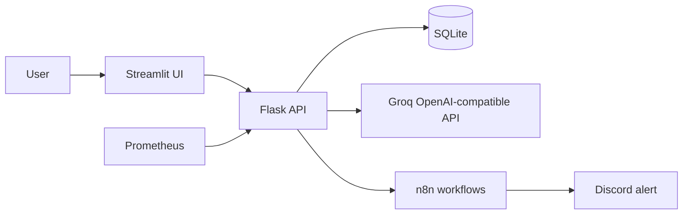

# SupportDesk AI architecture

## Responsibilities

- **Streamlit** provides chat, ticket management, knowledge ingestion, and metrics screens.
- **Flask** validates requests, persists tickets/documents, performs retrieval, calls the LLM, and exposes metrics.
- **SQLite** stores tickets, knowledge documents, conversations, and AI usage.
- **n8n** routes ticket events and invokes classification for priority-based automation.
- **Prometheus** scrapes the public `/metrics` endpoint for basic service counters.

## Request flow

Chat requests stream from Streamlit to Flask using server-sent events. Flask retrieves
matching knowledge snippets, sends grounded context to the configured model, and returns
the answer with citations. Ticket creation is persisted before the n8n webhook is called.
